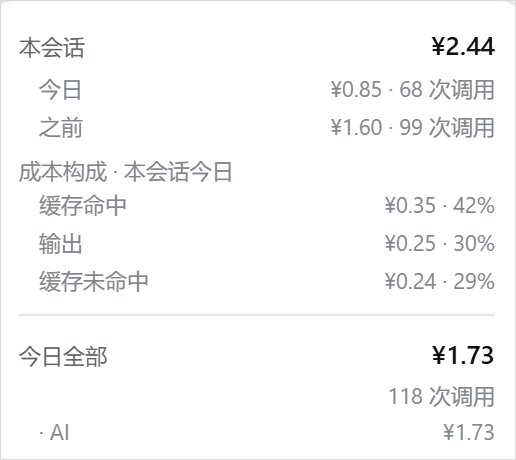

# dsh-cost-chip

[](https://github.com/chenqianes/dsh-cost-chip/actions/workflows/test.yml)
[](LICENSE)
[](https://www.npmjs.com/package/dsh-cost-chip)

> A cost chip for [DeepSeek Harness](https://github.com/deepseek-ai): shows what the current
> session has actually cost — with a breakdown by billing bucket (cache hit / cache miss /
> output) — plus today's total and your DeepSeek balance. Prices are synced from the official
> pricing page, and each call is priced with the table in force **at the moment it ran**.
>
> 中文说明在下方。`Node ≥ 22.15`（用到 `zlib.zstdDecompressSync`）。

安装（桌面端用的是 `desktop` profile；跑 `dsh web` 的换成 `web`）：

```bash
dsh plugin --profile desktop add dsh-cost-chip
```

装完**重启 DSH**。卸载把 `add` 换成 `remove` 即可。

在 DSH Web GUI 输入框下方**上下文百分比圆环的旁边**放一个小药丸，显示本会话花费；点开是今日花费、成本构成与 DeepSeek 余额。

```
[ 💰 ¥1.38 峰 ]  (◔ 12%)
```



<sub>余额已打码。</sub>

## 它显示什么

| 位置 | 内容 | 来源 |
| --- | --- | --- |
| 药丸 | **本会话今日**花费（可切换，见下） | 该会话日志里每条 `assistant/message` 的精确 `usage` × 单价 |
| 弹层「本会话」 | 该会话**累计**，下面**拆成「今日」与「之前」两行** | 同一条会话日志，按本地零点切分 |
| 弹层「成本构成」 | 药丸那个数**钱花在哪**：`缓存未命中` / `缓存命中` / `输出` 三行（金额 + 占比，悬停看 token 数）；同一口径下用过多个模型时再列两行模型 | 同一次汇总顺手算出来的，不发额外请求 |
| 弹层「今日全部」 | 今天所有会话、所有工作区的花费与调用次数，**下面按工作区各列一行**（最多 4 行，其余合并） | 今天动过的全部会话日志；工作区名取自会话头里的 `cwd` |
| 弹层「余额」 | DeepSeek 账户余额 | 已登录就取 DSH 自己的账户服务；没登录时退回 `GET https://api.deepseek.com/user/balance`，60 秒缓存 |

拆分只在 UI 上：子行金额之和等于对应总数，各自按记录发生时刻的价表与峰谷计价。
当前工作区那一行前面有个 `·`。

「成本构成」解释的是**药丸上那个数**（所以它跟着 `DSH_COST_CHIP_CHIP` 走），三行的
金额之和等于对应总数。之所以单列这一块：三个计费桶的单价差 50 倍（缓存命中 / 未命中 /
输出），只有总价的话，看数字的人只能瞎猜是哪一部分在烧钱——实测某天 6% 的钱来自
94% 的 token（缓存命中），另一次则是输出占了大头，两种情况的应对完全不一样。

弹层第一行的「本会话」始终是**累计**；药丸上那个数字默认是**本会话今日**（跨天会话用
累计值会看不出今天花了多少），可以切：

| `DSH_COST_CHIP_CHIP` | 药丸显示 |
| --- | --- |
| `today`（默认） | 本会话今日 |
| `total` | 本会话累计 |
| `all` | 今日全部（所有会话、所有工作区） |

工作区名为什么不用目录名：`$DSH_HOME/sessions` 下的目录键是有损编码
（`--D-work-~62A5~8868--` 这种，分隔符和连字符撞车），所以读会话
第一行里记的 `cwd`。

## 数字是怎么算的

host 半边直接读 dsh 自己的持久化真相：`$DSH_HOME/sessions/<workspace>/<session>/session.*.jsonl.zstd`。

- 日志是**追加式多帧 zstd**：每次落盘追加一个独立帧，`zstdDecompressSync` 只认第一帧，所以要逐帧解（魔数 `28 B5 2F FD`）。
- **续读只解新增的那一段**：缓存里记着最后一个完整帧结束的字节偏移，文件变长时用句柄定位读尾巴，不再整文件重解。整文件重解一趟是 100–200 ms 的**同步** CPU（2.45 MiB 的会话实测 160 ms），而轮询是常开的、弹层开着更密，这点开销恰好压正在出字的 host 主线程上。半帧（写到一半的帧）不解，等下一次追加补齐；文件被截断/重写则退回全量。
- **一个会话目录里可能有多份日志**（格式升级后旧的 `session.v3.*` 留着不删，往往是空壳）。按「版本号 > mtime > 大小」只取最新那份——否则按目录顺序读到旧壳子，整个会话会显示成 0。
- 每条 `assistant/message` 同时带 `data.usage`（`inputTokens` / `cacheReadTokens` / `cacheWriteTokens` / `outputTokens`）和 `data.message.source`（`{provider, model}`），所以按**每次调用当时用的模型**计价，不是拿会话当前选中的模型去套。注意 `inputTokens` 只是**未命中**的那部分，`totalTokens = inputTokens + cacheReadTokens + outputTokens`，所以「缓存未命中」直接取 `inputTokens`，不会把命中的 token 按全价再算一遍。
- 缓存按 `(size, mtime)` 失效，只有当天写过的文件才会被读。
- 「累计 / 今日 / 之前」三份汇总**一趟遍历**出完，每条记录只计一次价；今日按工作区拆也是同一趟里顺手累加的。

这比在浏览器里记账可靠：后台会话、没滚到的历史、重启前的调用都不会漏。

## 单价：跟官方页走

host 半边启动时（以及之后每 12 小时）抓一次官方定价页
`https://api-docs.deepseek.com/zh-cn/quick_start/pricing/`，解析出那张表：

- **逐模型的峰谷两套价**（不是「峰 = 谷 × 2」）；页面上本来就是两张独立的数。
- **高峰时段**：从页脚「北京时间周一至周五 9:00-12:00、14:00-18:00」的原文解析，
  改了口径下次同步就跟着变。
- **旧模型名的计费别名**：页脚若写「旧模型名 X、Y … 按 Flash 价格计费」，解析成
  别名表，`deepseek-v4-flash-vision-exp` 这类名字自动落到对应模型上。
- **法定节假日**：页脚原文是「周一至周五（不含中国法定节假日）9:00-12:00、14:00-18:00
  为高峰时段；其余时段，包括周末及中国法定节假日全天均为空闲时段」。所以节假日**全天
  按空闲价**。官方页只给规则、不给日期，具体哪天放假来自国务院通知，插件这样拿：

  1. 内置一份快照（`lib/holidays-data.js`，2025–2026），断网也能用；
  2. 按年从机器可读镜像刷新（默认 `timor.tech`），成功后落缓存、7 天内不重复抓；
  3. `DSH_COST_CHIP_HOLIDAYS` 手工叠加，优先级最高。

  某一年还没公布（比如 2027 在 10 月）时**不提示**——那是常态：周末与工作日已经能
  正确判定，缺的只是那年的法定节假日。只有**当年**的日历缺失才说明真的算不准，
  面板才会说一句。

  刷新是无感的：缓存 7 天，某年的通知一出来，下一次刷新就自动跟上，不用改配置。

### 时间线：调价不改写历史

每次同步到**不一样**的价表，就在 `$DSH_HOME/dsh-cost-chip.pricing.json` 里追加
一条带时刻的记录（最多 24 条）。汇总时**每条调用按它自己发生时刻生效的那份价表**
计价，所以官方调价不会把调价之前的金额重算一遍。

「第一次看到新价」不等于「新价开始生效」：官方可能提前挂价，也可能隔几小时才被抓到。
想跟账单严丝合缝就把生效时刻填进来：

```powershell
# 官方公告的生效时刻（任何 Date 认得的写法）
$env:DSH_COST_CHIP_PRICING_EFFECTIVE_FROM = '2026-10-01T00:00:00+08:00'
```

每条时间线记录有两个时刻，别混：`at` 是**生效时刻**（写定之后不再改），`checkedAt`
是**上次确认时刻**（每次同步都刷新，TTL 也看它）。分开的理由是调价那天写进去的
`at`，如果被后来的「确认没变」推成"现在"，夹在调价时刻和现在之间的历史调用就会
落回上一份价表，金额被悄悄重算一遍——那正是这一节开头承诺不做的事。

### 同步失败时怎么办

**不换价表**。继续用手上最后一份真实价，界面上显示「价表同步失败，沿用上次的价」。
只有在**从来没同步成功过**的机器上，才用内置兜底表（并明确标注「内置价表」）。

理由很直接：悄悄退回一组写死的数，等于在你没察觉的时候换了计价口径——
比显示一份「3 天没同步」的旧价危险得多。

### 可调项

| 环境变量 | 默认 | 作用 |
| --- | --- | --- |
| `DSH_COST_CHIP_PRICING_URL` | 官方定价页 | 换价格来源（自建镜像/代理） |
| `DSH_COST_CHIP_CHIP` | `today` | 药丸显示什么：`today` / `total` / `all` |
| `DSH_COST_CHIP_PRICING_EFFECTIVE_FROM` | 空 | 校准最新一次调价的生效时刻 |
| `DSH_COST_CHIP_HOLIDAYS` | 空 | 逗号分隔的 `YYYY-MM-DD`，手工叠加，优先级最高 |
| `DSH_COST_CHIP_HOLIDAYS_URL` | `https://timor.tech/api/holiday/year/{year}` | 放假安排镜像，`{year}` 会被替换 |
| `DSH_COST_CHIP_BASE_URL` | `https://api.deepseek.com` | 余额接口地址 |
| `DSH_COST_CHIP_SESSIONS_ROOT` | `$DSH_HOME/sessions` | 会话日志根目录 |

缓存文件：`$DSH_HOME/dsh-cost-chip.pricing.json`（价表时间线）、
`$DSH_HOME/dsh-cost-chip.holidays.json`（放假安排）。删掉任何一个就等于强制重新抓。

## 环境要求

- **DSH** 带 `webServer` / `slots` / `locale` 三个服务的版本（桌面端和 `dsh web` 都满足）。
- **Node ≥ 22.15**：会话日志是 zstd 压缩的，插件用 `zlib.zstdDecompressSync` 逐帧解
  （[Node 23.8 引入](https://github.com/nodejs/nodejs.org/blob/a2db8a5c09bb9e02492aaf257b6a42373d75a6e2/apps/site/pages/en/blog/release/v23.8.0.md)，
  同一特性回移到了 22.15 LTS）。桌面端自带运行时，通常不用管；用命令行跑 `dsh web`
  且系统 Node 较老时会在这里炸。
- 没有第三方依赖，不装任何 npm 包。

## 数据与隐私

这插件读你本机的东西，公开代码就是为了让这件事可以被核对：

| 读什么 | 为什么 | 去哪 |
| --- | --- | --- |
| `$DSH_HOME/sessions/**/session.*.jsonl.zstd` | 从 `assistant/message` 里取 token 用量与模型名 | **不出本机**。只解析、不转存；对话正文不读也不留 |
| `$DSH_HOME/.credentials.yaml` 里的 `DEEPSEEK_API_KEY` | 只在**没有登录账户**时用来查余额 | 只发往 `api.deepseek.com`（可用 `DSH_COST_CHIP_BASE_URL` 改） |
| 已登录账户的余额 | 优先走 DSH 自己的账户服务，不碰 key | 同上，走 DSH 的既有通道 |

对外只有三个请求：官方定价页（HTML）、`timor.tech` 放假安排镜像（只发年份数字）、
DeepSeek 余额接口。三个都可以用环境变量换成你自己的镜像或直接关掉。

写盘的东西只有三份缓存，都在 `$DSH_HOME` 下：价表时间线、放假日历、一份探针状态。

## 安装

插件是 profile 级的：装一次，这个 profile 下的所有会话都有。

### 从 npm 装（推荐）

```bash
dsh plugin --profile desktop add dsh-cost-chip
```

- 桌面端启动的是 **desktop** profile；用 `dsh web` 命令行启动的换成 `web`。
- `dsh plugin` 是 pnpm 的透传：这条命令等价于在 profile 里 `pnpm add dsh-cost-chip`，
  并把本包补进 `dsh.profile.bundles`。
- 装完**重启 DSH**（bundle 列表是启动时读的）。
- 卸载：`dsh plugin --profile desktop remove dsh-cost-chip`。

不想动 profile，也可以先看一眼包里有什么：

```bash
npm pack --dry-run      # 9 个文件：lib/ + cordis.patch.yml + README + LICENSE
```

### 从源码装（要改代码时）

```powershell
git clone https://github.com/chenqianes/dsh-cost-chip.git
cd dsh-cost-chip
node dev/install.mjs "$env:USERPROFILE\.dsh\profiles\desktop"
```

脚本做三件事，且**不跑 pnpm**（不动锁文件）：在 profile 的 `node_modules` **和**
`profiles/node_modules`（桌面端解析裸包名走的共享根）各建一个 junction；在 profile 的
`package.json` 补一条 `link:` 依赖；把本包加进 `dsh.profile.bundles`。
改动前会写 `*.before-dsh-cost-chip.bak` 备份。

### 手动装（不想跑脚本，也不想走 npm）

1. 在 `~/.dsh/profiles/desktop/package.json` 的 `dependencies` 里加
   `"dsh-cost-chip": "link:D:\\path\\to\\dsh-cost-chip"`；
2. 把 `"dsh-cost-chip"` 加进同文件的 `dsh.profile.bundles` 数组；
3. 在 profile 的 `node_modules` 下建一个指向本包目录的目录联接（Windows 用
   `mklink /J`，Linux/macOS 用 `ln -s`）；
4. 重启 DSH。

### 卸载

```powershell
# 从 npm 装的
dsh plugin --profile desktop remove dsh-cost-chip

# 从源码装的
node dev/install.mjs "$env:USERPROFILE\.dsh\profiles\desktop" --remove
```

### 装完为什么还要重启

bundle 列表是**启动时**读的，patch 热重载不覆盖新增 bundle。重启之后：

- 改 `lib/client.js` 会在几秒内自动热更（不用重启）；
- 改 `lib/index.js`（host 半边）仍需重启。

## 开发

```
lib/index.js        host 半边：读日志汇总、同步价表、查余额、两条 GET 路由
lib/client.js       浏览器半边：药丸 + 弹层（手写的 __ModuleLoader__ bundle，不打包）
lib/pricing.js      定价页解析（纯函数，无副作用）
lib/holidays.js     放假日历：内置快照 + 镜像刷新 + 手工覆盖
dev/                安装脚本、测试、探针
```

`dev/` 里前面几个是给使用者/CI 用的（`install`、`test-core`、`probe-client`、
`probe-pricing`、`probe-summary`），后面几个（`debug-decode`、`patch-row`、
`preflight`、`probe-host`、`probe-holidays`）是作者排查问题时留下的，正常用不到。

## 测试

```powershell
node dev/test-core.mjs            # 7 个回归用例
node dev/probe-summary.mjs [会话id]  # 不重启 DSH，在进程内跑一次 collect() 并断言结构
node dev/probe-client.mjs         # 离线渲染弹层，打印它到底会显示哪些字
```

`test-core.mjs` 覆盖：续读只解新增帧且 `offset` 落在帧边界、半帧不解且补齐后能接上、
文件被截断时旧记录不残留、**真实会话日志按任意字节边界长回去时记录始终是最终结果的前缀**
（防重复/错乱）、三个计费桶之和等于总额、价表时间线的确认同步不改写生效时刻。

`probe-summary.mjs` 用假的 `deepseekAccount` 服务跑真实的 `collect()`，直接验 host
半边的输出结构（含「账户余额优先」那条路），host 代码改完不必重启整个桌面端就能看结果。

## 探针

挂载时 host 会写一笔 `$DSH_HOME/dsh-cost-chip.state.json`：

```json
{ "hostAt": 1792390000000, "pid": 1234, "version": "0.1.0", "route": "/api/dsh-cost-chip/summary", "clientAt": 1792390001000 }
```

`hostAt` 存在 = 插件加载了；`clientAt` 存在 = 浏览器半真的挂到了页面上。用来在拿不到页面会话（接口有鉴权）时确认插件状态。

## 局限

- 花费是**估算**：按日志里的 token 数 × 官方页单价，和账单的差异来自调价生效时刻、
  以及官方对中断调用的计费口径。
- **放假安排靠镜像**：国务院只发通知，没有官方 JSON。插件用 `timor.tech` 的镜像刷新，
  失败时退回内置快照；两者都没有的年份会被标出来，不会假装知道。
- 调休上班的周六按周末算（非高峰），与官方「周一至周五」的字面口径一致。
- 只统计经过 DSH 的调用；同一个 key 在别处（脚本、别的客户端）烧的钱不在里面。
- 余额查询受 60 秒缓存限制。已登录时取 DSH 账户里的可用余额（和设置页同源），
  这时没有「赠送 / 充值」的拆分可显示；未登录才退回打 `/user/balance` 用 API key。
